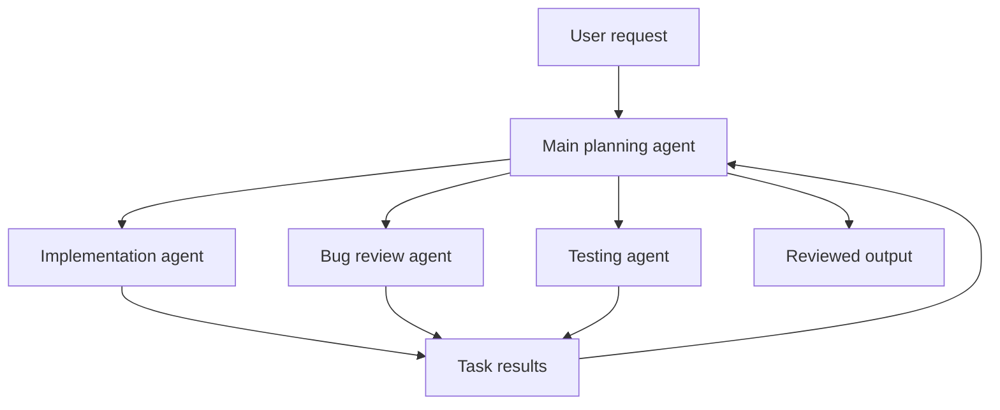

# Multi-Agent AI Coordinator

**Area:** AI system design / task delegation  
**Stage:** Architecture concept

## The challenge

A complex AI coding task can create too much information for a single model to manage effectively. I wanted to explore a system that could assign different tasks to different models while keeping a central coordinator focused on planning and decisions.

## My proposal

I proposed one capable **main agent** that plans work and delegates tasks to smaller models. The coordinator should not need to read every line of code being produced. Instead, specialised agents would work on defined responsibilities such as implementing a section or checking for bugs, then return useful results.

I also questioned whether such a system would exhaust context windows — an important limitation for multi-agent workflows.

## Design reasoning

| Decision | Reason |
| --- | --- |
| One main coordinator | Maintain a consistent plan and break work into tasks |
| Specialist subagents | Assign focused responsibilities such as code generation and bug review |
| Limit code passed to the coordinator | Reduce irrelevant context and information overload |
| Review agent results | Avoid assuming that generated code is automatically correct |

## Architecture concept

## What this demonstrates

This case shows **how I reason about AI systems**, including delegation, context management and the division of responsibilities. It is a design case study, not a claim that I have deployed and benchmarked this architecture.

## Evidence

Original discussion screenshots and any future prototype evidence will appear below.

<!-- Insert genuine screenshots here, e.g.  -->
