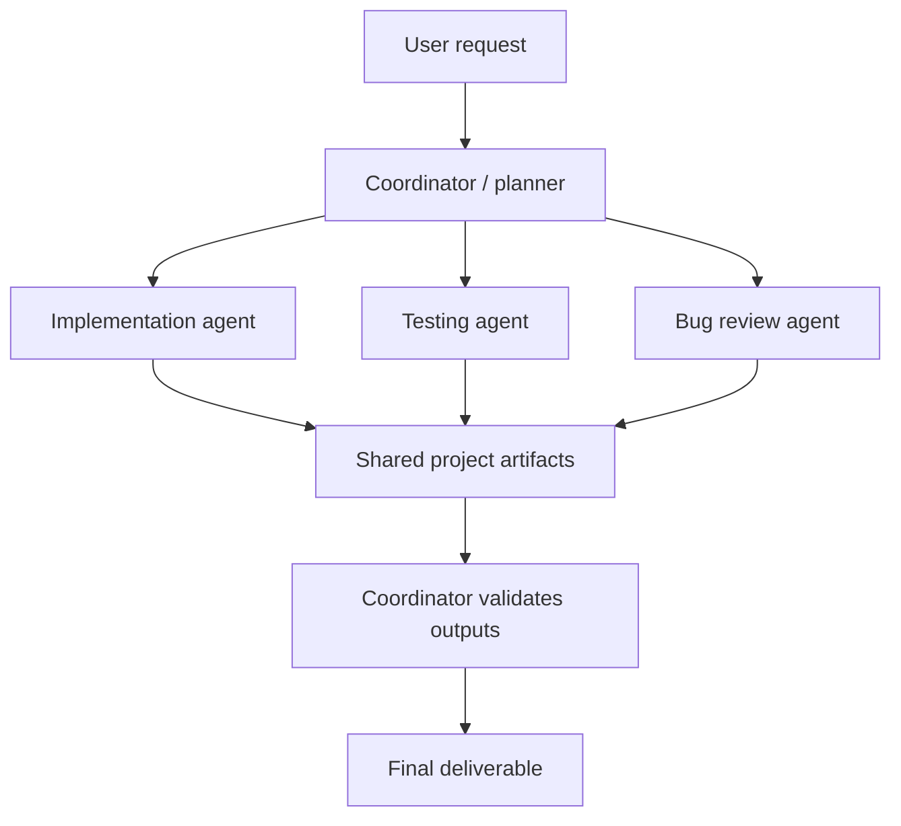

# Multi-Agent AI Architecture — Design Case Study

**Status: Concept discussed; implementation and testing not demonstrated.**

## Problem
How should a complex software task be divided between AI models without overloading the main model's context?

## Design concept
A strong coordinator model plans work, assigns tasks and checks completion. Smaller specialist agents independently implement components, inspect bugs or run tests. The coordinator receives concise summaries and acceptance-test results rather than every code file or tool trace.

## Trade-offs and failure modes
- Context windows: summaries save tokens but can omit details.
- Coordination: subagents may duplicate work or disagree on interfaces.
- Tool access: agents should have only the permissions needed.
- Evaluation: passing tests matters more than confident-sounding responses.
- Cost and speed: extra agents create overhead; a single agent may be better for small tasks.

## Evidence still needed
- [ ] A working orchestrator or repeatable simulation
- [ ] Exact coordinator/subagent prompts
- [ ] Sample task decomposition and outputs
- [ ] Comparison with a single-agent baseline
- [ ] Token usage, completion rate and/or latency data
- [ ] Reproducibility notes and limitations

**Portfolio claim:** This document demonstrates systems-design thinking, not a verified working multi-agent system.
